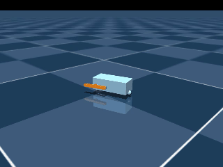
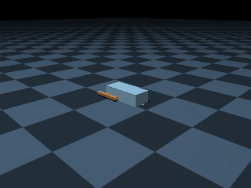
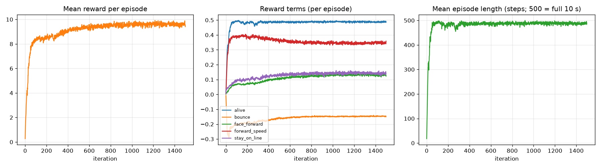
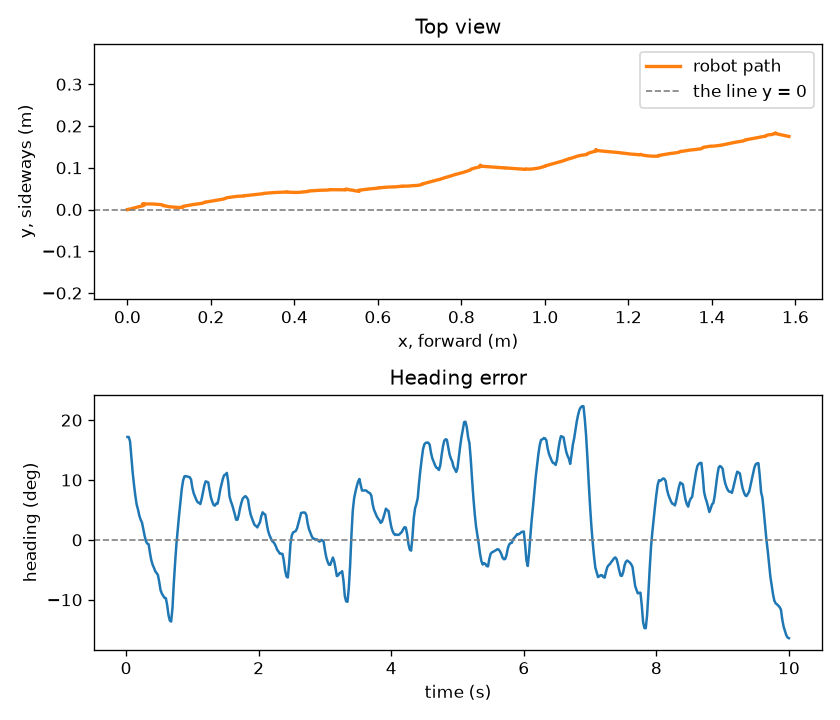

# Project 10: Drive Straight, a two-beam robot trained with rewards

A LEGO double motor turns two beams (legs) instead of wheels. Each leg moves in steps: the motor turns it forward 135
degrees, then holds it. A leg only pushes while its end is on the floor, so the robot lurches forward in bursts, and
stepping both legs the same way does not drive straight. I built the robot in Onshape, exported it to MuJoCo, and used
mjlab (reinforcement learning with PPO) to train a policy that decides when each leg takes its next step, so that the
robot drives straight down a line. A real LEGO car of about the same size is the comparison for how accurate the model is.

GitHub: <https://github.com/iliketocode2/ME193-Robotics/tree/Project-10-Simulated/Public%20stuff/projects/Project%2010%20-%20Simulated>

## Contents

1. [The robot: CAD and model](#the-robot-cad-and-model)
2. [The MuJoCo video](#the-mujoco-video)
3. [The reward system](#the-reward-system)
4. [The policy](#the-policy)
5. [Training results](#training-results)
6. [Running it](#running-it)
7. [Watching the training](#watching-the-training)
8. [Running it on the LEGO car](#running-it-on-the-lego-car)
9. [Reflection](#reflection)
10. [Files](#files)

## The robot: CAD and model


*Onshape drawing. Replace `media/cad.png` with a screenshot or drawing export of the Onshape assembly.*

| Part | Size | In the simulation |
|---|---|---|
| Chassis (holds the double motor) | 90 x 42 x 35 mm | 118 g (Onshape material; set `TOTAL_MASS` in `robot_model.py` to the weighed LEGO car) |
| Two beams | 60 mm long, 10 x 9 mm | 5 g each, one hinge each, through the beam's centre, across the robot |
| Front sphere | 20 mm diameter | slides on the floor (low friction), standing in for a ball caster |

The beams are 42 mm apart (centre to centre), and the sphere is 80 mm in front of the beam axles. The axles must be
well behind the body's centre of mass: in an earlier version they were 10 mm further forward, the front end of a beam
reached past the centre of mass, and the robot vaulted over backwards onto its back at every start.

The model comes from Onshape through [onshape-to-robot](https://onshape-to-robot.readthedocs.io/) (`onshape/`). The
beams are joined to the chassis by revolute mates named `dof_left_beam` and `dof_right_beam`, which the exporter turns
into the hinge joints `left_beam` (the +y side) and `right_beam`. `robot_model.py` then prepares the model: it removes
any angle limits, flips an axle whose mate arrow points the other way (in this assembly the two arrows point in
opposite directions, so the same command spun the beams opposite ways and the robot turned in place), gives the
beams 5 g each (they have no material in Onshape), and sets the friction. Only the beam ends grip the floor; the
chassis and sphere slide. (If the mates are missing, `robot_model.py` adds the hinges itself.)

**The motor.** Each leg's motor works like LEGO's `run_for_degrees(135)` followed by "hold": when told to step, it
turns its leg forward 135 degrees at `MAX_BEAM_SPEED` (12 rad/s, so a step takes about 0.2 s), then holds that angle
until the next step. Legs only move forward. In the simulation this is a position servo,
`torque = BEAM_KP * (target angle - angle) - BEAM_KD * speed`, capped at `BEAM_TORQUE_LIMIT`, whose target angle moves
135 degrees forward at 12 rad/s for each step (`StepMotor` in `robot_model.py`, `LegStepAction` in `beam_task.py`). The
numbers (12 rad/s, 0.15 N*m, `BEAM_KP` 2, `BEAM_KD` 0.05) are estimates for the double motor, in `robot_model.py`.

**Without any learning** (`check_model.py`, fixed stepping patterns):

| Time | Steps | x (m) | y (m) | Heading |
|---|---|---|---|---|
| 1 to 6 s | both legs step nonstop (about 5 steps a second each) | 0 to 1.06 | drifts to +0.38 | drifts left to +35 degrees |
| 6 to 9 s | only the left leg steps | 1.06 to 1.17 | about +0.4 | turns right, past -160 degrees |
| 9 to 12 s | the legs take turns | | | turns slowly |
| 12 to 15 s | both legs, one step every 0.5 s | | | barely moves |

Stepping both legs nonstop gives the top speed, 0.21 m/s, but the robot does not drive straight: it drifts to the left,
35 degrees off and 0.38 m sideways after 5 seconds. A leg pushes in bursts, and small differences between the two sides
(where each leg touches down, the body rocking) add up. Stepping only one leg turns the robot hard, so the timing of
the steps is enough to steer. That is the job for the learned policy: start turned away from the line, and decide when
each leg steps so that the robot still drives straight.

## The MuJoCo video

**Trained policy** ([full video, `media/policy.mp4`](media/policy.mp4)): the robot starts 0.3 radians (17 degrees) off
the line, turns back onto it and walks straight down it, each leg turning forward in 135-degree steps. Recorded by
`make_video.py`.



**Without learning** ([full video, `media/open_loop.mp4`](media/open_loop.mp4)): both legs stepping nonstop, then only
the left leg, then the legs taking turns, then slow steps (`check_model.py`).



## The reward system

Every policy step (50 per second) the robot gets the sum of these terms, times their weights. Training adjusts the
policy so the total over a 10-second run is as large as possible.

| Term | Weight | Formula | Why |
|---|---|---|---|
| `alive` | +0.5 | 1 every step | Without it, a robot that is not yet moving scores below zero every step (only penalties), so tipping over early looked better than surviving: the first training runs learned to flip. With it, surviving always pays. |
| `forward_speed` | +1.0 | `1 - ((vx - 0.15) / 0.15)^2`, at least -1 | Pays most for driving forward at 0.15 m/s. It slopes all the way down to standing still, so a robot that is not moving yet still learns which way is better. |
| `stay_on_line` | +0.5 | `exp(-(y / 5 cm)^2) * moving` | 1 on the line y = 0, 0.37 at 5 cm off, almost 0 beyond 10 cm. |
| `face_forward` | +0.5 | `exp(-(heading / 0.15 rad)^2) * moving` | 1 facing +x, 0.37 at 9 degrees off. It turns the robot back first: it must face the line before it can stay on it. |
| `bounce` | -1.0 | `vz^2 + 0.01 (roll rate^2 + pitch rate^2)` | Less throwing the body around. |

`stay_on_line` and `face_forward` are bonuses between 0 and 1, not penalties. The first version used penalties that grew
with the distance (`-(y / 10 cm)^2`): 0.5 m off cost 12 points per step, far more than `alive` pays, so a robot that had
drifted did better by leaving the line quickly and ending its run. A bonus can only be lost, never owed, so staying
on the line is always worth more.

Both are multiplied by `moving = clamp(vx / 0.15 m/s, 0, 1)`: 0 when standing still, 1 at the target speed. Without
it, a robot standing still on the line and facing forward collected both bonuses in full, and over training the policy
walked less and less (the `forward_speed` term fell by half between iterations 100 and 1500).

A run ends early, which loses all the reward the robot would have collected afterwards, if the robot tips more than
60 degrees or drifts 0.5 m from the line. Each run starts with the robot pointing up to 0.4 radians (23 degrees) off
the line and each beam up to 0.3 radians from flat, so the policy must learn to correct both.

## The policy

| | What | Size |
|---|---|---|
| **Sees** | sin and cos of the heading (2); turn rate (1); sin and cos of each leg's angle (4); each leg's speed (2); for each leg, whether a step is running and how far it still has to go (4) | 13 numbers |
| **Thinks** | a neural network with two hidden layers of 64 neurons (ELU) | 5,186 weights and biases |
| **Does** | one number per leg: above 0 means "start your next 135-degree step now" (ignored while that leg is still stepping) | 2 numbers |

The policy sees only what the real car can measure: the Double Motor's gyro gives the heading and turn rate, its
two motor encoders give the leg angles and speeds, and the program keeps track of the step state itself. It does not
see how fast it is going or how far it is from the line, because the LEGO car cannot measure those. (An earlier version
did see them and drove a little better in the simulation, but it could not have run on the car.) The critic, which is
used only during training, does see speed and line offset: that helps it judge the policy's actions. The policy also
does not see its own previous output: with it, a policy that once said "wait" while the car stood still saw nothing
change and could keep saying "wait" forever (it happened in a dry run of `lego_drive.py`).

The policy steers only by timing: stepping the right leg more often than the left turns the robot left, and the other
way round. The leg angles and the step state tell it where each leg is in its stroke, because a leg pushes hardest when
it is near vertical and not at all while it is up in the air.

**A first version that did not work.** At first the policy chose a speed for each leg, forwards or backwards, at any
moment. It found a trick: it rocked both legs back and forth about 13 times a second and shuffled forward, with the
legs never turning all the way round. In the simulation that drove straight (within 1 cm over 1 m), but the real motors
could never do it, and it is not how the robot is meant to move. Limiting the motors to forward 135-degree steps took
the trick away. It is a good example of reward hacking: the policy optimizes exactly what the rewards measure, not what
I meant.

It is trained with PPO (proximal policy optimization): 4096 copies of the robot drive at once on a GPU, each for
24 steps; then the network is nudged toward the actions that earned more reward than expected. One such round is an
iteration. A second network of the same size (the critic) learns to predict the reward to come, which tells PPO which
actions were better than expected.

## Training results

Trained on the Tufts cluster (one GPU, 4096 robots, 1500 iterations, about 8 minutes). This is the final policy: it
sees only what the LEGO car can measure (heading, turn rate, leg angles and speeds, step state), and it is the one in
`lego/policy.npz`.





| | Forward in 10 s | Sideways (y) | Heading |
|---|---|---|---|
| No learning, both legs stepping nonstop (`check_model.py`) | 1.06 m in 5 s | drifts to 0.38 m in 5 s | drifts to +35 degrees in 5 s |
| Final policy (`make_video.py`, starting 17 degrees off) | 1.58 m (0.16 m/s), 45 steps per leg | ends 17.5 cm to the left (at most 18.4 cm) | 7.4 degrees off on average, at most 22 |

The policy walks steadily, about 4.5 steps per second on each leg, and keeps its heading near straight. Because it
cannot see the line, small heading errors add up to a slow sideways drift (17.5 cm over 1.6 m): it drives *straight*,
but it cannot steer back onto the line. Earlier versions that could see their speed and line offset stayed within
3.4 cm, but they could not run on the car.

**How the policy got here** (each version trained the same way, about 8 minutes):

| Version | What happened | What I changed |
|---|---|---|
| 1. Legs as free-speed motors | Rocked both legs back and forth 13 times a second and shuffled forward (reward hacking) | Legs only step forward 135 degrees at a time |
| 2. 135-degree steps, line/heading penalties | Robots that drifted left the line on purpose to end the run (penalties grew faster than `alive` paid) | Line and heading became bonuses between 0 and 1 |
| 3. Bonuses | Stayed within 3.4 cm of the line, but used speed and line offset, which the car cannot measure | Policy sees only gyro and encoder readings |
| 4. Real-car inputs | Walked less and less; in a dry run of `lego_drive.py` it stopped after 3 steps and never restarted | Bonuses only while moving forward; removed the policy's own last output from its inputs |
| 5. Final | Walks steadily, 1.58 m in 10 s, heading near straight, drifts 17.5 cm sideways | |

## Running it

Everything runs from a WSL terminal in the `mujoco-hpc` folder, which has the cluster tools (`runIt.py`). Turn on the
Tufts VPN if you are off campus. Each command asks for your password and Duo the first time in 2 hours.

```
cd ~/Github_Projects/mujoco-hpc
```

**0. (Only after changing the CAD) export it again** from Onshape, in `10_drive_straight/`:
```
cd 10_drive_straight && ../.venv/bin/onshape-to-robot onshape && cd ..
```

**1. Check the model** (about 1 minute; brings back `open_loop.mp4`):
```
python3 runIt.py --gpu --with 10_drive_straight/onshape --with 10_drive_straight/robot_model.py \
  10_drive_straight/check_model.py
```

**2. Short training test** (64 robots, checks that everything loads; a few minutes):
```
python3 runIt.py --gpu --time 00:10:00 --mem 16G --cpus 4 \
  --with 10_drive_straight/onshape --with 10_drive_straight/robot_model.py --with 10_drive_straight/beam_task.py \
  10_drive_straight/train.py Beam-Drive-Straight --env.scene.num-envs 64 --agent.max-iterations 20
```

**3. Full training** (4096 robots, 1500 iterations, about 13 minutes):
```
python3 runIt.py --gpu --time 00:45:00 --mem 16G --cpus 4 \
  --with 10_drive_straight/onshape --with 10_drive_straight/robot_model.py --with 10_drive_straight/beam_task.py \
  10_drive_straight/train.py Beam-Drive-Straight --env.scene.num-envs 4096
```
The checkpoints come back to `runs/train-<time>/logs/rsl_rl/beam_drive_straight/<date>/model_<n>.pt` (every 50 iterations;
the last one is `model_1499.pt`). `runIt.py` waits until the job ends; Ctrl-C stops the waiting, not the job.

**4. Make the video** of the trained policy (put your own run folder in place of the `X`s; Tab completes them):
```
python3 runIt.py --gpu --time 00:10:00 --mem 16G --cpus 4 \
  --with 10_drive_straight/onshape --with 10_drive_straight/robot_model.py --with 10_drive_straight/beam_task.py \
  --with runs/train-XXXXXXXX-XXXXXX/logs/rsl_rl/beam_drive_straight/XXXX-XX-XX_XX-XX-XX/model_1499.pt \
  10_drive_straight/make_video.py model_1499.pt
```
It brings back `policy.mp4`, `trajectory.csv` and `trajectory.png`, and prints x, y and heading once a second.

**5. Plot the training** (once: `.venv/bin/pip install tensorboard matplotlib`):
```
.venv/bin/python 10_drive_straight/plot_training.py runs/train-XXXXXXXX-XXXXXX 10_drive_straight/media/training_curves.png
```

Copy the results you want in the write-up into `media/`: `cad.png`, `policy.mp4`, `policy.gif`, `trajectory.png`,
`training_curves.png` (`open_loop.mp4` and `open_loop.gif` are already there).

### Tuning (in `beam_task.py` and `robot_model.py`)

- **Match the real car first**: weigh it (`TOTAL_MASS`), and measure its top speed with both motors at full power. If the
  real car is slower than the 0.21 m/s here (both legs stepping nonstop), lower `MAX_BEAM_SPEED`; then set `TARGET_SPEED` a bit below the top speed.
- **Wobbles along the line**: raise the `face_forward` or `stay_on_line` weights, or narrow `LINE_WIDTH` / `HEADING_WIDTH`.
- **Crawls or stops**: `TARGET_SPEED` is too high for the motor, or `bounce` is too strong (it can pay to stand still).
- **Flips**: lower `BEAM_TORQUE_LIMIT`.

## Watching the training

- **The text output, live**: `python3 status.py --watch` shows the job state. To see each iteration (mean reward, each reward
  term, episode length) as it happens, open a second terminal: `ssh hpc`, then
  `tail -f ~/mujoco-hpc/runs/train-*/slurm-*.out` (Ctrl-C stops watching, not the job).
- **Live graphs (TensorBoard)**: in a second WSL terminal, `ssh -L 6006:localhost:6006 hpc`, then on the cluster
  ```
  source ~/mujoco-env/bin/activate
  tensorboard --logdir ~/mujoco-hpc/runs --port 6006
  ```
  and open <http://localhost:6006> in a Windows browser. The graphs update every few seconds while training runs.
- **After the run, on your laptop**: `.venv/bin/tensorboard --logdir runs` (after `.venv/bin/pip install tensorboard`), then
  open <http://localhost:6006>; or make the PNG with `plot_training.py` (step 5).
- **The robot itself**: `make_video.py` (step 4) on any checkpoint, including one from the middle of training, to see what
  it has learned so far.

## Running it on the LEGO car

`lego/lego_drive.py` runs the trained network on your laptop and drives the real car over Bluetooth, through the
same `lelib.py` as the other ME193 projects. It needs `policy.npz` (the network as plain numpy arrays), which
`make_video.py` writes next to the video; copy it into `lego/`. Use a normal Windows or Mac terminal, not WSL (WSL
has no Bluetooth):
```
cd "Public stuff/projects/Project 10 - Simulated/lego"
pip install legoeducation numpy
python lego_drive.py test          # 1. each leg turns 45 degrees: answer whether it went the right way; times a step
python lego_drive.py open_loop 5   # 2. both legs step nonstop for 5 s, no policy (compare with check_model.py)
python lego_drive.py policy 10     # 3. the trained policy drives for 10 s
```
Before each run, put the car on the floor facing the way it should go, with **both legs level** (horizontal): the
program calls that leg angle 0 and heading 0, as the simulation does.

Every 1/50 s it reads the gyro and the two motor encoders, builds the same 13 numbers as the simulation (in the same
order as `actor_terms` in `beam_task.py`), runs the network in numpy, and for each leg whose output is above 0 and that
is not already stepping, moves that leg's target 135 degrees further forward (`motor_run_to_relative_position` with
the motor set to hold between steps). Each run is logged to `lego_run_<mode>.csv`.

Settings at the top of `lego_drive.py`: `FORWARD_SIGN` (which way each motor counts forward; `test` tells you),
`STEP_SPEED` (motor speed for a step; the simulation assumes 12 rad/s, a 135-degree step in 0.2 s, and `test` measures
yours), and `CARD_SERIAL` / `CARD_COLOR` if several Double Motors are nearby.

What can differ from the simulation: the real step speed and how fast Bluetooth delivers readings and commands (the
loop prints its rate; the simulation decides 50 times a second), the gyro's sign and units, and friction and mass.
If the car turns the wrong way in `policy` mode, flip `YAW_SIGN`.

## Reflection

*Answer these after training and testing the LEGO car.*

1. How close was the simulated robot to the real LEGO car (top speed, how straight it drives with equal power, how it
   bounces)? What in the model is most likely wrong (mass, friction, motor speed and torque, the sphere sliding instead
   of rolling)?
2. Which reward term mattered most? What happened when you changed a weight?
3. What did the policy learn to do with the two beams? Does it keep them in step?
4. Would the trained policy work on the real car? What would it need (heading from a gyro, beam angles from the motor
   encoders)?
5. What would you change next time?

## Files

| File | What it does |
|---|---|
| `onshape/` | The Onshape export: `config.json` (which document), `robot.xml`, `scene.xml`, `assets/` (STL meshes) |
| `robot_model.py` | Builds the robot from the export: beam hinges, masses, friction, and the motor constants |
| `check_model.py` | Drives the beams with fixed commands, no learning; writes `open_loop.mp4` and `open_loop.csv` |
| `beam_task.py` | The mjlab task `Beam-Drive-Straight`: observations, rewards, resets, PPO settings |
| `train.py` / `play.py` | mjlab's train and play commands with the task registered |
| `make_video.py` | Runs a trained policy for 10 s: `policy.mp4`, `trajectory.csv`, `trajectory.png`, and `policy.npz` for the LEGO car |
| `plot_training.py` | `training_curves.png` from the TensorBoard logs |
| `lego/lego_drive.py` | Runs the trained policy (or a fixed stepping pattern) on the real LEGO car over Bluetooth |
| `lego/lelib.py` | The class's LEGO Education wrapper (copy of `useful libraries/lelib.py`) |
| `lego/policy.npz` | The trained network as numpy arrays, written by `make_video.py` |
| `media/` | CAD drawing, videos and plots used in this write-up |
| `.gitignore` | Keeps `.env` (Onshape keys) and training output out of git |
