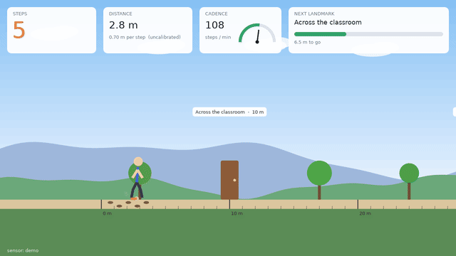
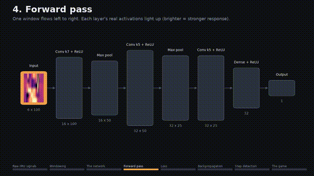
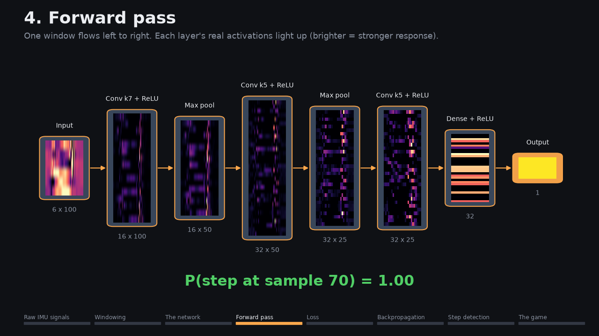
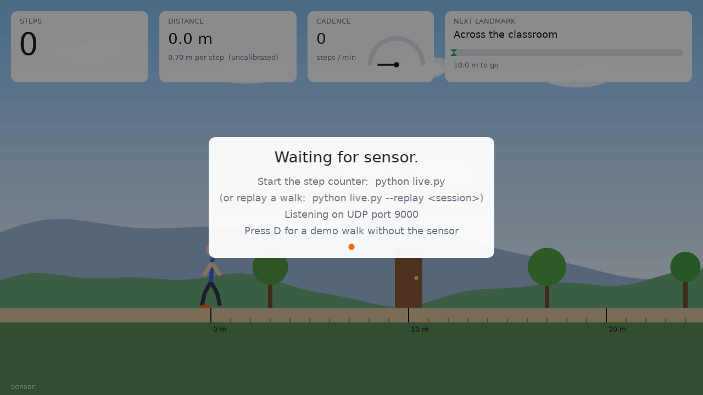

# Project 8 – How Many Steps

A neural-network step counter built on the Project 7 shoe wearable. A 1D CNN
trained in PyTorch reads every motion channel of the IMU and counts steps,
and a LÖVE game turns the count into distance walked across a world that
unlocks real-distance landmarks.

**Code on GitHub:** [Project-8-steps branch](https://github.com/iliketocode2/ME193-Robotics/tree/Project-8-steps/Public%20stuff/projects/Project%208%20-%20How%20Many%20Steps)



## Contents

1. [Demo video](#demo-video)
2. [The hardware](#the-hardware)
3. [How the system fits together](#how-the-system-fits-together)
4. [How the neural net works](#how-the-neural-net-works)
5. [Explainer animation](#explainer-animation)
6. [Running it](#running-it)
7. [Uncertainty analysis](#uncertainty-analysis)
8. [The game](#the-game)
9. [Design notes](#design-notes)
10. [Files](#files)
11. [Reflection questions](#reflection-questions)

## Demo video

**[DEMO VIDEO LINK GOES HERE]**

What the video should show:

1. The shoe with the wearable on it, and the laptop running `live.py` next to the LÖVE game.
2. You say a number out loud (for example 30), then walk exactly that many steps while the camera keeps both
   your feet and the game in view.
3. Each footstep landing at the same moment as a footprint and dust puff in the game, and the step counter,
   cadence gauge and distance climbing live.
4. Standing still and shaking the foot for a few seconds without the counter moving.
5. The final count next to the number you said.

## The hardware

The walker is the **Project 7 wearable**: an **Arduino UNO Q** strapped to the top of a shoe with an
**MPU-6050** IMU. The sensor code is reused unchanged from Project 7 (`unoq_app/sketch/sketch.ino`).

| Sensor channel | Range / units | Used |
| --- | --- | --- |
| Accelerometer x, y, z | ±16 g (2048 counts per g) | yes |
| Gyroscope x, y, z | ±2000 °/s (16.4 counts per °/s) | yes |
| Die temperature | °C | no: it measures the chip, not motion |
| Magnetometer | none: the MPU-6050 doesn't have one | – |

So "every available sensor channel" is all six motion channels.

**How the readings reach the computer:** the UNO Q's STM32 microcontroller reads the MPU-6050 over I²C at
**100 Hz** and passes batches of 10 samples (every 100 ms) to the UNO Q's Linux side through the Arduino
Bridge. `unoq_app/python/main.py` serves them on **TCP port 5005**, one line per batch with a sequence
number so dropped batches show up as gaps. App Lab only forwards TCP ports, which is why this hop isn't UDP.

## How the system fits together

```txt
MPU-6050 ──I²C 100 Hz──▶ UNO Q MCU (sketch.ino) ──Bridge──▶ UNO Q Linux (main.py) ──TCP :5005──▶ laptop
                                                                                                    │
  collect.py  ─▶ data/sessions/*.csv + *.json  (live SPACE-bar labels)                              │
  label_tool.py ─▶ fix step marks on a plot                                                         │
  train.py    ─▶ models/step_cnn_all.pt (+ normalization stats, threshold) + plots/training_curves  │
  evaluate.py ─▶ plots/ + results/ + the results section of this README                             │
  live.py     ◀─────────────────────────────────────────────────────────────────────────────────────┘
      │  every 40 ms: last 1 s → CNN → P(step) → debounce → steps, cadence, distance
      └──UDP :9000 (JSON)──▶ LÖVE game (game/)
```

## How the neural net works

The network sees one second of motion at a time: 100 samples of the six IMU channels (three accelerations
and three rotation rates), each scaled by the mean and spread measured on the training data. Its one job is
to answer a yes-or-no question about that window: "does a foot land at sample 70?" Sliding the window forward
every 40 ms turns those answers into a probability curve that bumps up once per step. A simple debouncer then
turns each bump into exactly one counted step, and never counts two within a quarter second.

Inside, three convolution layers slide small pattern detectors (7 and 5 samples wide) along time. The first
layer learns short shapes such as the sharp jolt of a heel strike or the swing of the shoe's rotation; the
deeper layers combine them into longer patterns like "jolt, then swing, then quiet", which separates a real
step from a bump, a shake or a turn. Two dense layers at the end weigh all of that evidence into a single
number, which a sigmoid squashes into a probability. Every pattern and weight is learned from examples; none
is hand-written.

Training started from random weights. For each batch of labeled windows the network made its guesses, and
binary cross-entropy measured how wrong they were: small when it was confidently right, large when it was
confidently wrong. Backpropagation then used the chain rule to work out, for every one of the network's
weights, which direction would have made that loss smaller, passing the error backward from the output layer
to the first. The Adam optimizer nudged each weight a small step in that direction, and repeating this over
many batches is what slowly turned random filters into step detectors. Whole recording sessions were held back
for validation and testing, so the scores come from walks the network never saw.

## Explainer animation

[media/how_it_works.mp4](media/how_it_works.mp4) walks through the whole system in about a minute: raw IMU
signals → windowing → network layers → forward pass → loss → backpropagation → step detection → game. It's
rendered by `explainer.py` with matplotlib from the real `StepNet`. The activations are captured with forward
hooks and the gradients come from a real `loss.backward()`. The loss curve and the changing first-layer
weights come from a short training run inside the script.





The current render uses `data/sample/walk_project7`: 20 s of real walking recorded with this same wearable in
Project 7. Its step marks were auto-suggested by `label_tool.py`, not hand-checked, and the network in it was
trained on that same clip, so it is an illustration, not a measurement. After you train on your own data,
re-render with your trained model and one of your sessions:

```
python explainer.py --session <one of your labeled sessions>
```

## Running it

All commands run from this folder. Training needs PyTorch; on this laptop that's `my_env_cpu`, which has the
CPU build for Python 3.14.

```
pip install -r requirements.txt
```

**1. Put the stream app on the board.** Copy `unoq_app/` into your `ArduinoApps` folder (for example as
`step-counter/`) and deploy it with **Ctrl+Shift+B → Run on UNO Q** (or `python tools/deploy.py step-counter`).
Set `BOARD_HOST` in `config.py` to your board's IP or name, or pass `--board <ip>` to each script.

**2. Collect data.** Each run records one session to `data/sessions/`. Press **SPACE every time a foot lands**
(either foot) and **Q** to stop.

```
python collect.py --activity walk       # 8+ sessions, 30-60 s each, different speeds
python collect.py --activity turn       # turning on the spot and around corners
python collect.py --activity stairs     # up and down
python collect.py --activity carry      # walking while carrying something
python collect.py --activity still      # standing / sitting, no labeling needed
python collect.py --activity shake      # shaking or tapping the foot without stepping, no labeling needed
```

Record at least three sessions of each activity so whole sessions can be held out for validation and testing.

**3. Label (fix the marks).** Key presses lag your real steps by your reaction time.

```
python label_tool.py                    # newest session; or give a session name
```

Left click adds a step, right click removes the nearest one. **[** and **]** shift every mark by 20 ms (use
them to remove your reaction lag). **P** suggests this foot's landings from acceleration peaks, **M** adds the
other foot's steps halfway between consecutive marks, and **S** saves.

**4. Train.**

```
python train.py                         # all six channels  -> models/step_cnn_all.pt
python train.py --channels accel        # ablation: accelerometer only -> models/step_cnn_accel.pt
```

**5. Record uncertainty trials.** At least 10, with counts you check by hand, for example 20, 50 and 100 steps:

```
python collect.py --trial-steps 50
```

**6. Evaluate.** This writes the plots, `results/`, and the results section below.

```
python evaluate.py
```

**7. Calibrate stride length.** Walk a measured distance; the script divides it by the step count.

```
python calibrate.py --distance 20
```

**8. Run live and launch the game.** Start the game in one terminal and the counter in another:

```
cd game && love .
python live.py
```

`python live.py --replay <session>` replays a recorded session in real time, so you can show the game
without the wearable. Install LÖVE from [love2d.org](https://love2d.org) (on Windows, `scoop install love`
from the extras bucket also works).

## Uncertainty analysis

<!-- RESULTS:START -->
Not run yet: record at least 10 known-count trials (`collect.py --trial-steps N`), train both models, then run
`python evaluate.py`. It replaces this section with the per-trial errors, mean absolute error, percent error,
standard deviation, a 95% confidence interval on percent error, false positives (standing, shaking, turning)
reported separately from missed steps, the accelerometer-only ablation, and these plots: predicted vs actual
steps, the error distribution, and a sample trace with true and predicted steps marked.
<!-- RESULTS:END -->

**How the numbers are computed.**

- **Per trial:** error = predicted − actual, and percent error = error ÷ actual.
- **Mean absolute error:** the average of |error| over all trials.
- **Confidence interval:** the 95% interval on the mean percent error uses the t-distribution, because 10–20
  trials is too few for the normal approximation.
- **False positives vs missed steps:** these use held-out labeled sessions. A predicted step is correct if it
  lands within 200 ms of a true one. A predicted step with no true step nearby is a false positive, and a true
  step that no prediction matched is a miss.
- **Ablation:** the same test sessions and trials are scored by the accelerometer-only model.

## The game

The game is in `game/` (`main.lua`, `conf.lua`) and listens for live.py's JSON on UDP port 9000 using LÖVE's
built-in LuaSocket.

- **Walking:** a character walks across a scrolling, parallax world. Every detected step swings a leg and
  leaves a footprint and a dust puff, so the animation follows your real steps.
- **Live readouts:** the step counter pulses on each step, the cadence gauge shows steps per minute, and the
  distance is shown in meters or kilometers.
- **Landmarks:** they unlock at real distances, with a banner and confetti: across a classroom (10 m), a
  hallway (30 m), a football field (91 m), half and full track laps (200 m, 400 m), 1 km, a mile, a 5K, the
  height of Everest and a marathon. A bar shows the distance to the next one.
- **No data:** when nothing has arrived for 2 s, it shows a "waiting for sensor" screen instead of failing.
  **D** starts a demo walk without the sensor, **F** fast-forwards the demo, **R** resets and **Esc** quits.



## Design notes

- **One shoe, both feet.** The IMU only rides on one shoe, but a "step" is either foot landing. The other
  foot's landing happens while the instrumented shoe is mid-swing (a large gyroscope signal), which is one
  reason the gyroscope matters. The ablation measures how much it helps.
- **Low latency.** The network judges sample 70 of each 1 s window, not the middle, so it has 0.7 s of
  history and needs only 0.3 s of look-ahead. That keeps the game's footprints within about 0.3–0.4 s of
  the real step.
- **One detector everywhere.** `StepDetector` turns probabilities into steps the same way in training
  (threshold tuning on validation sessions), evaluation and live mode, so the tuned threshold means the same
  thing live.
- **Splitting by session.** Train, validation and test are split by whole recordings, about 70/15/15 for each
  activity, so the test windows come from walks the model never saw. Trial recordings are used only for
  evaluation.
- **Fixed sample rate.** Sessions are resampled onto an even 100 Hz grid, which also fills any batch lost in
  transit. The per-channel normalization stats from the training split are saved inside the model file, and
  live mode uses them as-is.

## Files

| File | What it does |
| --- | --- |
| `unoq_app/` | UNO Q app: `sketch/sketch.ino` (Project 7's MPU-6050 reader) and `python/main.py` (TCP stream) |
| `config.py` | Board address, ports, sample rate, window, tolerances, folders |
| `imu_stream.py` | TCP client: raw counts → g and °/s with the board's sample clock |
| `collect.py` | Records sessions, with live SPACE-bar step labels and a known-count trial mode |
| `keys.py` | Non-blocking key reads for the terminal (Windows, macOS, Linux) |
| `label_tool.py` | Plot-based step labeling and correction |
| `dataset.py` | Session files, resampling, normalization, sliding windows, the split by session |
| `model.py` | `StepNet`, the 1D CNN, plus saving and loading |
| `stepcount.py` | Window probabilities → debounced steps, and event matching for scoring |
| `train.py` | Training, threshold tuning, training-curve plot (`--channels accel` for the ablation) |
| `evaluate.py` | Uncertainty analysis, plots, results tables |
| `calibrate.py` | Stride-length calibration → `calibration.json` |
| `live.py` | Live counting (or `--replay`) → UDP to the game |
| `explainer.py` | Renders `media/how_it_works.mp4` |
| `game/` | The LÖVE game |
| `data/sample/` | 20 s of real walking from Project 7, used by the explainer |

## Reflection questions

[PASTE REFLECTION QUESTIONS HERE]
