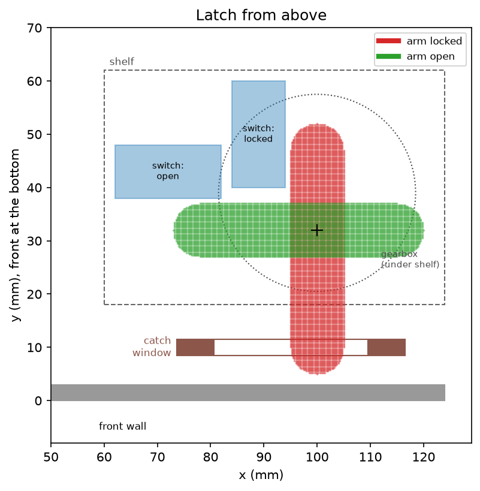
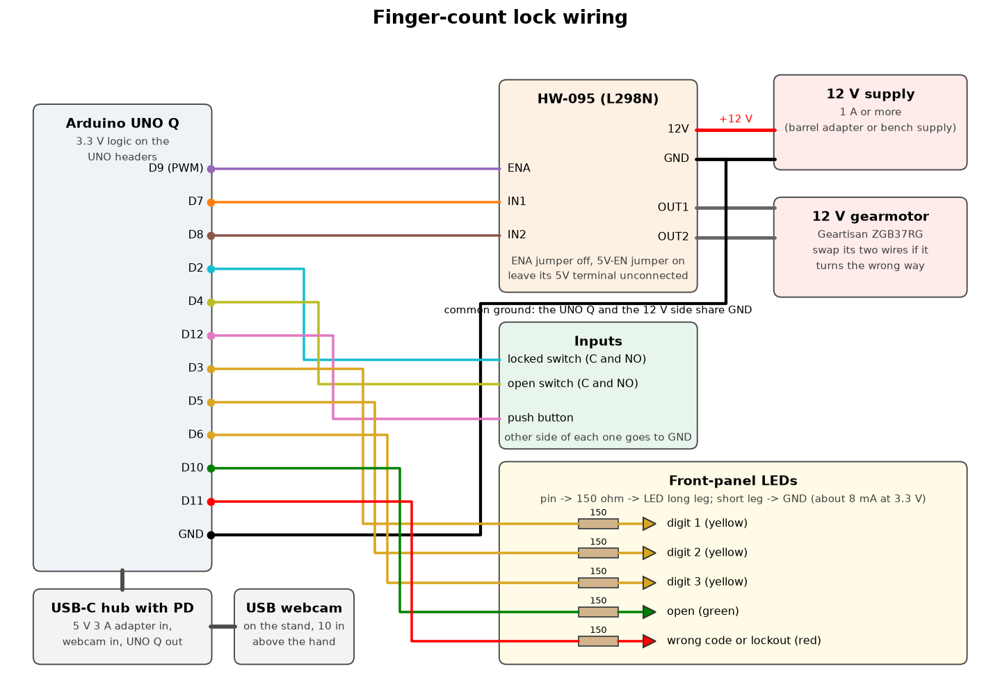

# Project 9: Midterm 2, the finger-count lock

A lock that opens when you show the camera the right sequence of three finger counts. A convolutional neural
network, written in PyTorch and trained on photos of my own hand, reads how many fingers are showing. It runs on
the computer first, with a USB webcam, and then on the Arduino UNO Q.

## Contents

1. [Part 1: fitting the V data](#part-1-fitting-the-v-data)
2. [Part 2: the finger-counting network](#part-2-the-finger-counting-network)
3. [Part 3: the lock policy](#part-3-the-lock-policy)
4. [Part 4: the box, latch and circuit](#part-4-the-box-latch-and-circuit)
5. [Part 5: the code on the UNO Q](#part-5-the-code-on-the-uno-q)
6. [Running it](#running-it)
7. [Collecting good data](#collecting-good-data)
8. [Files](#files)

## Part 1: fitting the V data

`v_fit/` holds the gradient-descent warm-up: the V data from Anna's Code (`make_v_data.py`, `v_data.tsv`) and
`V Fit Gradient Descent.xlsx`, which trains a straight line, one ReLU neuron and a layer of two ReLU neurons with
spreadsheet formulas. The line can only flatten out through the middle of the V, one ReLU neuron fits one arm,
and two ReLU neurons fit the whole V.

## Part 2: the finger-counting network

The camera looks down at the spot where you hold your hand. The program cuts out the center square of each frame,
turns it gray, and shrinks it to 64 x 64 pixels. Each image is then standardized (its mean brightness subtracted
and divided by its spread) so a brighter or darker room changes the numbers less.

FingerNet (`model.py`) has three convolution layers, each followed by ReLU and 2 x 2 max pooling, and one linear
layer at the end:

| Layer | What it does | Output size |
| --- | --- | --- |
| input | grayscale image | 1 x 64 x 64 |
| conv1 | 8 filters, 5 x 5, then ReLU and pooling | 8 x 32 x 32 |
| conv2 | 16 filters, 3 x 3, then ReLU and pooling | 16 x 16 x 16 |
| conv3 | 32 filters, 3 x 3, then ReLU and pooling | 32 x 8 x 8 |
| linear | 2048 numbers in, one score per answer | 6 |

A convolution filter is a small grid of weights that slides across the image and gives a large output wherever
the patch under it matches its pattern. The first layer learns simple patterns such as edges between skin and
background. Later layers combine those into finger-shaped pieces. Max pooling keeps the strongest response in each
2 x 2 block, which halves the image size and lets later layers see a wider area. The final linear layer weighs all
2048 values and gives a score to each answer from 0 to 5 fingers. Softmax turns the scores into probabilities.

The network has about 18,000 weights. Training uses cross-entropy loss, which is small when the network puts a high
probability on the right count, because this is a choice between six categories rather than a number to estimate.
`loss.backward()` runs backpropagation, the chain rule from the V-fit spreadsheet applied through every layer,
and the Adam optimizer takes the gradient-descent step.

Augmentation (`dataset.augment`) makes every training batch a little different. Each photo is rotated up to 20
degrees, shifted up to 12% of the frame, zoomed between 85% and 115%, mirrored half the time (a left hand becomes
a right hand), and given a random brightness and contrast change. None of these change the number of fingers,
so each altered copy is a new, correctly labeled example. `python train.py --no-augment` trains the same network
without it, to measure how much it helps.

For the UNO Q, `npnet.py` repeats the same forward pass in plain numpy (convolution, ReLU, pooling, linear,
softmax), so the board does not need PyTorch. `train.py` checks that both versions give the same probabilities.

## Part 3: the lock policy

`lock_policy.py` holds the rules and nothing else, so the same file runs on the computer and on the UNO Q. It gets
one reading per camera frame (the most likely count and how sure the network is) plus button presses, and it says
which LEDs to light and when the latch opens. The settings are in `config.py`.

An attempt starts with the button. Before each digit the hand has to leave the view, so the network reads 0 for
0.4 seconds. Then you show a count from 1 to 5 and hold it. The digit is accepted when the network gives the same
count, at least 80% sure, for one full second without a break, and one digit LED lights. A single wrong frame
restarts the second. Requiring the empty view between digits is what lets a code repeat a digit, such as 3, 3, 5,
and it stops one long hold from being read as two digits.

After the third digit the whole code is checked at once, so a wrong attempt gives no hint about which digit was
wrong. The right code opens the latch for 5 seconds and then it locks itself. A wrong code shows red for a moment.
Three wrong codes in a row start a 30 second lockout during which the button does nothing. Ten seconds without a
new digit cancels the attempt, and pressing the button mid-attempt cancels it too.

`lock.py` runs the policy with the webcam. SPACE stands in for the button, and the dots along the bottom match
the LEDs on the box: three yellow digit LEDs (the next one blinks while the lock is listening), a green LED for
open and a red one for a wrong code, which blinks during the lockout. Each event goes into `results/lock_log.csv` with its time, which gives
the time taken to unlock. The digits are never logged.

## Part 4: the box, latch and circuit

`hardware/make_parts.py` writes every laser-cut part as a DXF in millimeters, for 3 mm plywood. The red CUT layer
is cut through and the blue ENGRAVE layer is a light score line. `hardware/dxf/box_sheet_*.dxf` and
`stand_sheet_*.dxf` have the parts packed onto 300 x 300 mm sheets, and `hardware/dxf/parts/` has each part on its
own. All sizes are settings at the top of the script.

The box is 127 x 127 mm (5 x 5 in) and 108 mm tall with the lid, with finger joints on every outside edge. The lid
is the door, hinged along the back edge with two small hinges or a strip of cloth glued across the seam. Inside:

- The front-right corner is a closed tower for the motor. The gearmotor hangs upside down from a shelf, with its
  shaft poking up through the shelf.
- A two-layer plywood arm on the shaft is the latch. A catch plate hangs from the lid with a window in it. When the
  arm turns to point at the front, its tip goes through the window, and the lid can't lift. When it turns to point
  left, the window is free.
- Two small limit switches on the shelf tell the board when to stop the motor. The arm's tail presses one when it
  is locked, and the arm presses the other when it is open. Glue each switch to its spacer where the engraved
  outline is, after checking it clicks at the right spot with the arm in place.
- The UNO Q, the motor driver and the USB-C hub sit on the floor under a removable false floor, which rests on
  six small cleats 35 mm up. Above it is the storage space. The back panel of the motor tower is held only by its
  floor tabs, so you can lift it out when the false floor is out.
- The LEDs and the button go through the front face, inside the tower. Cables come in through a hole in the back
  (power) and the left side (webcam).



The camera stand is a 200 x 220 mm base, a hollow 30 mm square column and an arm with a gusset. The webcam lens
ends up 254 mm (10 in) above the base, looking straight down at the engraved cross. A plain background matters a
lot, so cover the base with matte paper. The network was trained on photos from a different angle, so after the
stand is built, collect a new set of photos from it and retrain.

The circuit (`hardware/wiring.py` draws it):



| UNO Q pin | Goes to | Notes |
| --- | --- | --- |
| D9 (PWM) | HW-095 ENA | remove the ENA jumper; PWM sets the motor speed |
| D7, D8 | HW-095 IN1, IN2 | one high and one low picks the direction; both low stops |
| D2 | locked limit switch | switch between the pin and GND, internal pull-up |
| D4 | open limit switch | same |
| D12 | push button | same |
| D3, D5, D6 | yellow digit LEDs | each through a 150 ohm resistor, short leg to GND |
| D10, D11 | green and red LEDs | same |
| GND | HW-095 GND | the UNO Q and the 12 V supply must share ground |

The UNO Q's header pins run at 3.3 V. The L298N on the HW-095 counts anything above 2.3 V as high, so the pins
can drive it directly. The 12 V supply goes to the HW-095's 12V and GND terminals, and the motor to OUT1 and OUT2.
The driver loses about 2 V, so the motor gets about 10 V. Keep the HW-095's 5V-EN jumper on so it powers its own
logic, and leave its 5V terminal unconnected, because its regulator cannot supply the UNO Q. The UNO Q gets power
through a USB-C hub with power delivery, which also takes the webcam. The board code should stop the motor if a
limit switch has not clicked within about 1.5 seconds, so a missed switch can't stall the motor against the stop.

Before cutting, measure your motor and plywood with calipers, update the settings in `make_parts.py`, and run it
again. The motor numbers are a best guess for a 37 mm gearmotor with an off-center shaft: gearbox length 70 mm
or less, a 12 mm boss, a 6 mm D-shaft, and six M3 holes on a 31 mm circle. Cutting the shelf from cardboard
first is a cheap way to check the screw holes line up.

## Part 5: the code on the UNO Q

The UNO Q has two processors. `uno_q/finger_lock/` is an Arduino App Lab app with a part for each:

- `python/main.py` runs on the Linux side. It reads the webcam, runs the numpy network, and feeds the readings
  and button presses to `lock_policy.py`, the same file the computer uses.
- `sketch/sketch.ino` runs on the microcontroller. It reads the button, lights the LEDs it is told to, and drives
  the motor until a limit switch clicks, stopping it if no switch clicks within 1.5 seconds.

The two talk over the Bridge: the sketch sends `button` and `latch`, and Python calls `set_leds` and `set_latch`.
`python uno_q/sync_app.py` copies the shared files and the trained weights into the app, and with
`--host <board IP>` it also copies the app to the board over SSH and starts it.

To see what the board sees, open `http://<board IP>:8000` in a browser on the same Wi-Fi. `python/viewer.py`
streams the camera with the reading, the lock state, the latch position, the LEDs and the 64 x 64 image the
network gets drawn on top. It only encodes frames while the page is open.

On the box the latch stays open until the button is pressed, because locking with the lid still up would leave
the arm in the catch's way. `RELOCK_AFTER_S` in `main.py` brings back the timed relock.

The sketch has two checks that work without the Python side. Every LED lights in turn at power-up, and the yellow
LEDs chase back and forth until Python starts talking. Holding the button while the board powers up opens the
latch and locks it again. A fast red flicker means a limit switch did not click in time.

## Running it

```bash
pip install -r requirements.txt

python collect.py --list        # find the webcam's index, then set CAMERA_INDEX in config.py
python collect.py               # photograph your hand; 0-5 picks the label, SPACE takes a burst
python train.py                 # about 40 epochs; writes models/, plots/ and results/
python train.py --no-augment    # optional: the same network without augmentation, for comparison
python live.py                  # live finger count; press f to see the feature maps
python live.py --numpy          # the same, using the numpy network the UNO Q will run
python lock.py                  # the lock; SPACE is the button
python lock.py --hide           # the lock without the live reading on screen
```

`train.py` saves these plots:

| Plot | Shows |
| --- | --- |
| `plots/training_curves.png` | loss and accuracy for each epoch, training and validation |
| `plots/confusion.png` | which counts get mixed up with which |
| `plots/mistakes.png` | the validation photos it got wrong |
| `plots/augmentation_examples.png` | one photo per count and five random altered copies |
| `plots/conv1_filters.png` | the eight 5 x 5 filters the first layer learned |
| `plots/feature_maps.png` | one photo passing through each layer, and the final probabilities |

## Collecting good data

- Use the USB webcam, mounted where it will sit on the safe, looking down at a plain background.
- Take at least two sessions for every label, on different days or in different light. `train.py` holds out each
  label's newest session for validation. Photos from one burst are near copies of each other, so testing on the
  same session would overstate the accuracy.
- Aim for 150 to 300 photos per label. During a burst, move your hand: closer and farther, tilted, left hand and
  right hand, different finger combinations for the same count (for 2, both index and middle, and thumb and pinky).
- Label 0 covers a fist and the empty view with no hand, so the lock can tell when you take your hand away.

## Files

| File | Purpose |
| --- | --- |
| `config.py` | camera index, crop size, image size, paths |
| `camera.py` | opens the camera and turns a frame into the network input (OpenCV and numpy only) |
| `collect.py` | labeled photo capture |
| `dataset.py` | loading, the session-based split, and augmentation |
| `model.py` | FingerNet in PyTorch, checkpoint saving, numpy weight export |
| `npnet.py` | the same network's forward pass in numpy, for the UNO Q |
| `train.py` | training, plots, and the numpy check |
| `live.py` | live finger count with probabilities and feature maps |
| `lock_policy.py` | the lock's rules: digit acceptance, code check, timeout, lockout |
| `lock.py` | the lock on the computer, with on-screen LEDs and an event log |
| `hardware/make_parts.py` | writes the laser-cut DXFs and preview images for the box and camera stand |
| `hardware/wiring.py` | draws the wiring diagram |
| `uno_q/finger_lock/` | the App Lab app for the UNO Q: `python/main.py` and `sketch/sketch.ino` |
| `uno_q/sync_app.py` | copies the shared files and weights into the app, and can send it to the board |
| `v_fit/` | Part 1, the V-data gradient-descent spreadsheet |
